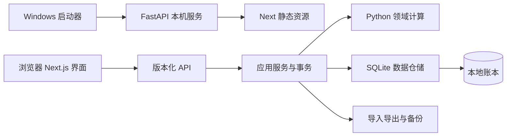

# 架构与技术决策

状态：用户确定 Next.js + FastAPI。以下部署细节为设计基线，M0 实测后锁定依赖版本。

## ADR-001：Next.js + FastAPI + SQLite

前端采用 Next.js App Router、React、TypeScript strict；后端采用 Python、FastAPI、Pydantic、Decimal；SQLite 存储账本，SQLAlchemy 数据访问，业务 schema 使用 Alembic 迁移。单仓库管理，不部署远程服务。代价是两套工具链及前后端契约维护。

## ADR-002：生产环境单个本地服务

Next.js 使用 `output: 'export'` 导出静态资源，由 FastAPI 同源提供页面与 `/api/v1`。安装后不需 Node 服务，不使用 SSR、Server Actions、Next API Routes 或运行时图片优化，全部业务计算在 Python。

构建仍使用 Next.js 和 Node。运行时详情使用固定页面加查询参数，例如 `/investments/detail/?id=...`，不要求构建时预生成本地标的动态路由。真实账本绝不参与静态构建。

开发环境运行 Next 开发服务与 FastAPI，优先通过 Next 开发代理转发 API；生产不沿用开发跨域白名单。

## 1. 模块边界

| 目录 | 职责 |
| --- | --- |
| frontend/ | 页面、组件、API client、输入提示；不向 localStorage／IndexedDB 复制账本 |
| backend/app/api/ | 路由、会话、请求和响应模型 |
| backend/app/application/ | 用例、事务、幂等、版本冲突与操作记录 |
| backend/app/domain/ | 金额、持仓、成本和汇总覆盖规则，不依赖框架 |
| backend/app/infrastructure/ | 数据仓储、文件、备份、日志 |
| backend/migrations/ | 数据库版本迁移 |
| backend/tests/ | 领域与数据库集成测试 |
| launcher/ | 单实例、端口、服务就绪、打开浏览器、退出及打包 |
| contracts/ | OpenAPI 契约和前端生成类型，仅合成示例 |

同一账本只允许一个服务实例写入。连接按请求／线程管理，SQLite 写事务串行化；繁重导出用任务状态，不阻塞界面。

## 2. 启动与退出

1. 启动器取得账本单实例锁；重复启动唤起已有实例，不另启写入进程。
2. 系统分配空闲端口，持有已绑定套接字交给服务，避免先探测再绑定的竞争。仅绑定 `127.0.0.1`，不得使用 `0.0.0.0`。
3. 生成高熵、短期、一次性引导凭据，就绪后打开 `http://127.0.0.1:<port>/#bootstrap=...`；片段不随 HTTP 请求发送。
4. 前端读取后立即用 history.replaceState 清除片段，交换为 HttpOnly、SameSite=Strict 会话 Cookie；引导凭据一次使用后失效。
5. 数据、文件和退出 API 全部验证会话；刷新延续会话，服务重启失效。不要求用户设置密码。
6. “退出软件”完成／取消任务、关闭数据库、停止服务并释放锁。关标签不等于退出，启动器提供可见状态与退出入口。

防护目标是阻止无关网页操作本机服务；不能阻止已控制 Windows 账户的程序读取未加密数据。引导凭据仍敏感，不承诺对浏览器历史、扩展完全隐身；清除流程须实测，不记录凭据到日志。

## 3. 本地 HTTP 安全

- 精确校验 Host 与端口，防 DNS rebinding；监听回环地址本身不够。
- 数据 API 需认证；写请求校验精确 Origin、CSRF token 及预期 JSON／受控上传类型；协议拒绝缺少 Origin 的写请求。
- 生产不开放任意 CORS；测试错误 Host／Origin、无会话、过期会话、恶意表单和预检请求。
- CSP 约束脚本和连接来源；字体、图标、脚本全部随包分发；不使用不可信 HTML。会话、数据 API 和财务下载使用 `Cache-Control: no-store`；不启用财务 service worker 缓存。
- 不暴露任意服务器路径读写；上传下载或启动器文件选择受控，限制体积、类型和解包目标。
- 生产关闭交互式 API 文档；错误不返回 SQL 和堆栈；日志不记录正文、Cookie、凭据、金额或备注。
- 核心运行无出站请求；关闭遥测、远程崩溃上报和自动更新。构建下载与运行数据隔离。

## 4. API 契约

前缀 `/api/v1`；Pydantic/OpenAPI 定义接口，生成 TypeScript 类型，CI 检查同步。日期 YYYY-MM-DD，时间戳为带时区 ISO 8601。

资源示例：`POST /transactions`、`POST /transfers`、`POST /investment-events`、`POST /imports/preview`、`POST /imports/commit`、`POST /backups`、`POST /restores/preview`、`POST /restores/commit`。字段在对应功能实现时按数据模型定义。

金额、价格和份额用十进制字符串传输，后端转换 int／Decimal，禁止 float；最终验证在后端。列表分页、筛选、排序均受服务端约束。

写请求带 Idempotency-Key；修改用 revision／If-Match，过期返回 409；预览 token 绑定数据版本和输入摘要，提交时重验。错误统一 `{ error: { code, message, field_errors?, request_id } }`，成功返回资源，不用 HTTP 200 表示业务失败。

## 5. 打包与 M0 验证

拟用 PyInstaller onedir 打包 Python、FastAPI、启动器与 Next 静态资源，再制作 Windows 安装包。用户无需安装 Python 或 Node。安装目录与账本目录分离，更新／卸载不得误删数据。独立桌面外壳为后续可选项。

工具候选：npm、uv 锁文件、Ruff、mypy、pytest、Vitest、Playwright。运行版本和依赖在 M0 核对支持矩阵后锁定。

M0 必须验证：干净 Windows 标准账户安装启动、无 Node/Python 环境运行、断网加载、中文路径、端口冲突、重复启动、安全退出、API 鉴权、数据库事务和备份恢复。未通过先解决部署，再开发业务。

## 6. 官方参考

- [Next.js 静态导出](https://nextjs.org/docs/app/guides/static-exports)
- [FastAPI 中间件](https://fastapi.tiangolo.com/advanced/middleware/)
- [SQLite 在线备份 API](https://www.sqlite.org/backup.html)
- [PyInstaller 打包](https://pyinstaller.org/en/stable/usage.html)

核对日期：2026-10-26。依赖版本与部署细节仍需实测。

## ADR-003：M0 实施边界（历史基线）

M0 先实现单表元数据 schema v1 和未知版本拒绝；不含业务数据迁移，不覆盖旧库。恢复后保留独立副本，切换由 --data-dir 指定，完整账本选择界面后续实现。改名使用 revision 防冲突，金融事件幂等与修订将在 M1 实现。

Next 内联启动脚本按构建产物计算 CSP SHA-256 白名单，不开放 script unsafe-inline；显式禁用 FastAPI telemetry 的 tracing／metrics／logs／operation_spans／auto_configure。

当前使用便携目录而非安装向导；源码开发先构建静态页面再用启动器运行，带认证的 Next 热更新代理尚未实现。以上均在运行指南说明，不视为全部 M0 安装门槛已通过。

## ADR-004：M1 日常账务与 schema v2

账户、分类、金融事件、现金分录、修订与幂等记录已经落地。类型特有字段先集中在 financial_events，避免首版引入多层一对一表；字段、约束和口径详见 M1 实施文档。

写入使用 BEGIN IMMEDIATE 事务串行化，核对完整历史现金时间线后提交。金额全程整数分；失败回滚事件、现金分录、修订和幂等记录。汇总与分页读取同一快照。修改要求 revision，重试使用幂等键；前端在丢失响应后保留原键直到完整读取成功。

升级前验证备份，Alembic revision 0001→0002 与 user_version 同事务提交。备份校验除数据库完整性外，还重放账务事实核对分录投影；v1 备份在新目录恢复后升级，不覆盖当前账本。迁移脚本以资源文件随程序打包。

## ADR-005：账户彻底删除与备注推导

为响应用户明确的彻底删除要求，AccountDeletion 在现有事务服务上实现保存点预览、关联退款闭包、删除前备份、名称确认和账本版本校验。删除当前账本中的实体及相关修订，幂等结果以无个人内容的失效标记保留，避免旧请求复活数据；只记录最小删除凭证，不保留完整被删除快照。

删除普通表时开启 secure_delete；新备份在独立快照上 VACUUM 压实，避免将旧空闲页内容复制进新备份。旧备份仍保存原数据，不承诺磁盘或日志的取证擦除。参考 [SQLite secure_delete](https://www.sqlite.org/pragma.html#pragma_secure_delete)。

常用备注直接从分类匹配的有效流水按规范化备注聚合，按频次与最近使用排序，不新增学习表，不使用浏览器持久存储。两项功能均沿用 schema v2，无需数据库迁移。
